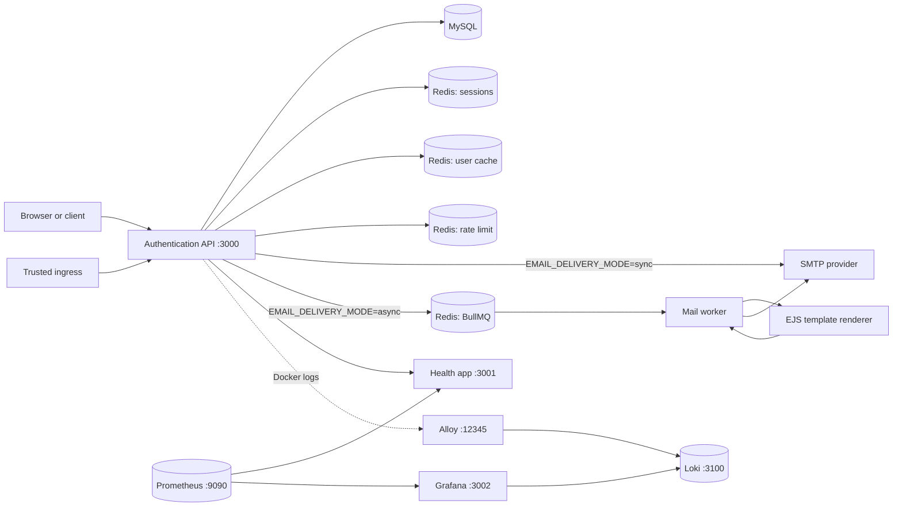

# Copyright and Usage Restrictions

© 2026 Urva Patel. All Rights Reserved.

This repository is publicly accessible solely for viewing and evaluation.

Without prior written permission from the copyright owner, you may not copy,
download, modify, redistribute, commercially exploit, or incorporate this
repository into another project.

No license is granted to use, modify, or distribute this software.


# Authentication & Mail Service

This repository contains two cooperating Node.js services:

- **Authentication service**: account signup and verification, login, JWT
  sessions, password reset, Google OIDC, profile operations, and authorization.
- **Mail service**: BullMQ worker, EJS templates, SMTP integration, retries,
  and graceful worker shutdown.

The authentication service can send emails synchronously over SMTP or enqueue
mail jobs for the external mail worker. Delivery mode is selected with
`EMAIL_DELIVERY_MODE=sync|async`.


## Architecture



### Mail delivery flow

For template mail, authentication callers provide only a template identifier
and template data:

```js
await emailService.sendEmail({
    to: normalizedEmail,
    subject: 'Verify your email address',
    template: 'verify-email',
    templateData: {
        name,
        verificationUrl,
        tokenExpiry: '30 minutes'
    }
});
```

In synchronous mode, the authentication email service renders the EJS template
and sends it directly through Nodemailer.

In asynchronous mode, it validates the same payload and adds a job to the
`mail` BullMQ queue. The external mail worker resolves the allowlisted
template, renders HTML and plain text, and sends the message through SMTP.


## Runtime services

| Service/container | Responsibility | Host access |
|---|---|---|
| `auth_service` | Authentication API, Passport, JWTs, profiles, and mail delivery adapter | `localhost:3000` |
| `mail_service` | BullMQ worker, template rendering, and SMTP delivery | Internal |
| `redis_bullMQ` | BullMQ queue storage | `localhost:6379` from Compose publishing |
| `redis_session` | Express/server-side sessions | Internal |
| `redis_user_cache` | User/profile cache | Internal |
| `redis_rate_limit` | Distributed rate limits | Internal |
| `mysql` | Authentication and identity persistence | `localhost:3306` |
| Health app | Startup, liveness, readiness, and metrics | `localhost:3001` |
| `prometheus` | Metrics collection | `localhost:9090` |
| `grafana` | Metrics/log visualization | `localhost:3002` |
| `loki` | Central log storage | `localhost:3100` |
| `alloy` | Docker log collection | `localhost:12345` |


## Repository layout

```text
.
├── auth_service/
│   ├── src/
│   │   ├── services/mainApp/auth/email.service.js
│   │   └── infrastructure/messaging/bullMQ/
│   ├── tests/
│   ├── migrations/
│   └── .env.example
├── mail_service/
│   ├── src/
│   │   ├── config/
│   │   ├── constants/
│   │   ├── queues/
│   │   ├── workers/
│   │   ├── processors/
│   │   ├── services/
│   │   ├── integrations/
│   │   ├── templates/
│   │   ├── errors/
│   │   └── server.js
│   └── .env.example
├── .env.database
├── .env.database.example
├── .env.monitoring
├── .env.monitoring.example
├── conf/monitoring/
└── docker-compose.yml
```


## Prerequisites

- Docker with Docker Compose v2
- Node.js 22+ and npm for host-side development
- MySQL 8
- Redis for sessions, cache, rate limiting, and BullMQ
- SMTP credentials for email delivery
- Google OAuth credentials only for Google OIDC


## Environment setup

Copy the example environment files:

```bash
cp .env.database.example .env.database
cp .env.monitoring.example .env.monitoring
cp auth_service/.env.example auth_service/.env
cp mail_service/.env.example mail_service/.env
```

Then replace placeholders and set real secrets.

### Database and infrastructure

`.env.database` contains MySQL, MongoDB, and Redis settings shared by Compose:

- `MYSQL_*`
- `MONGO_*`
- `REDIS_*`
- `SESSION_REDIS_*`
- `USER_CACHE_REDIS_*`
- `RATE_LIMIT_REDIS_*`
- `BULLMQ_REDIS_*`

`.env.monitoring` contains Prometheus, Grafana, Loki, and Alloy host settings.

### Authentication service

Important authentication variables:

| Group | Variables |
|---|---|
| Application | `ENVIRONMENT`, `PORT`, `HEALTH_APP_PORT`, `API_BASE_URL`, `FRONTEND_BASE_URL`, `CORS_ORIGIN` |
| MySQL | `MYSQL_HOST`, `MYSQL_PORT`, `MYSQL_USER`, `MYSQL_PASSWORD`, `MYSQL_DATABASE` |
| Redis | `SESSION_REDIS_*`, `USER_CACHE_REDIS_*`, `RATE_LIMIT_REDIS_*` |
| JWT/session | `JWT_*`, `SESSION_*`, cookie options |
| Mail delivery | `EMAIL_DELIVERY_MODE`, `EMAIL_HOST`, `EMAIL_PORT`, `EMAIL_SECURE`, `EMAIL_USER`, `EMAIL_PASSWORD`, `EMAIL_FROM` |
| BullMQ | `BULLMQ_REDIS_*`, `MAIL_QUEUE_NAME`, `MAIL_JOB_*` |
| OIDC | `OIDC_GOOGLE_*` |
| Ingress | `INGRESS_SHARED_SECRET` |

`EMAIL_DELIVERY_MODE` accepts:

- `sync`: send immediately through the authentication service SMTP client.
- `async`: publish the mail payload to BullMQ for the mail worker.

The SMTP variables are required for synchronous delivery. They are not required
for authentication startup when `EMAIL_DELIVERY_MODE=async`, although the mail
service still needs valid SMTP configuration.

### Mail service

The mail service reads:

| Group | Variables |
|---|---|
| Application | `ENVIRONMENT`, `SERVICE_NAME`, `PORT`, `HEALTH_APP_PORT` |
| SMTP | `EMAIL_HOST`, `EMAIL_PORT`, `EMAIL_SECURE`, `EMAIL_USER`, `EMAIL_PASSWORD`, `EMAIL_FROM`, `EMAIL_TIMEOUT_MS` |
| BullMQ Redis | `BULLMQ_REDIS_HOST`, `BULLMQ_REDIS_PORT`, `BULLMQ_REDIS_USERNAME`, `BULLMQ_REDIS_PASSWORD`, `BULLMQ_REDIS_DB`, `BULLMQ_REDIS_TLS` |
| Queue | `MAIL_QUEUE_NAME`, `MAIL_JOB_ATTEMPTS`, `MAIL_JOB_BACKOFF_TYPE`, `MAIL_JOB_BACKOFF_DELAY_MS`, `MAIL_REMOVE_ON_COMPLETE`, `MAIL_REMOVE_ON_FAIL` |
| Worker | `MAIL_WORKER_CONCURRENCY`, `MAIL_WORKER_MAX_STALLED_COUNT`, `MAIL_WORKER_STALLED_INTERVAL_MS`, `MAIL_WORKER_LOCK_DURATION_MS` |
| Shutdown | `FORCE_CLOSE_TIMEOUT_MS` |

Generate secrets with a random-value generator rather than reusing development
values:

```bash
openssl rand -base64 32
```


## Quick start

Run commands from the repository root.

### 1. Create environment files

```bash
cp .env.database.example .env.database
cp .env.monitoring.example .env.monitoring
cp auth_service/.env.example auth_service/.env
cp mail_service/.env.example mail_service/.env
```

Configure at least:

- MySQL and Redis credentials
- JWT/session/ingress secrets
- BullMQ Redis credentials
- SMTP credentials
- `EMAIL_DELIVERY_MODE`

Set `EMAIL_DELIVERY_MODE=sync` for direct SMTP behavior or `async` for the
separate mail worker.

### 2. Start the stack

```bash
docker compose --env-file .env.database up --build -d
```

For foreground logs:

```bash
docker compose --env-file .env.database up --build
```

### 3. Apply migrations

```bash
docker compose exec auth_service npm run db:migrate
```

Optionally load development seed data:

```bash
docker compose exec auth_service npm run db:seed
```

### 4. Verify processes

```bash
curl http://localhost:3001/startup
curl http://localhost:3001/live
curl http://localhost:3001/ready
curl http://localhost:3001/metrics
docker compose logs mail_service
```


## Mail templates

The mail worker includes allowlisted templates:

| Template constant | Template file | Subject |
|---|---|---|
| `verify-email` | `src/templates/verifyEmail.ejs` | Verify your email address |
| `forgot-password` | `src/templates/forgotPassword.ejs` | Reset your password |

Template data is validated before rendering. Template names are not converted
into file paths, preventing arbitrary files or traversal paths from being
rendered.

BullMQ jobs use this general shape:

```json
{
  "name": "verify-email",
  "data": {
    "to": "user@example.com",
    "template": "verify-email",
    "subject": "Verify your email address",
    "data": {
      "name": "Ada",
      "verificationUrl": "https://example.com/verify/token",
      "tokenExpiry": "30 minutes"
    }
  }
}
```


## API overview

All public application routes are versioned below `/v1`.

| Method | Path | Description |
|---|---|---|
| `POST` | `/v1/auth/signup` | Create a pending signup and send account verification mail |
| `GET` | `/v1/auth/verify-email` | Verify the account using the emailed token |
| `POST` | `/v1/auth/login` | Authenticate and set access/refresh cookies |
| `POST` | `/v1/auth/verify` | Validate an access token and produce ingress identity headers |
| `POST` | `/v1/auth/refresh` | Issue a new access-token cookie |
| `POST` | `/v1/auth/logout` | Clear access and refresh cookies |
| `POST` | `/v1/auth/forgot-password` | Send a password-reset link when the account exists |
| `POST` | `/v1/auth/change-password` | Consume a reset token and change the password |
| `GET` | `/v1/auth/oidc/google` | Start Google OIDC login |
| `GET` | `/v1/auth/oidc/google/callback` | Complete Google OIDC login |
| `GET` | `/v1/profile/me` | Read the authenticated profile behind trusted ingress |
| `PATCH` | `/v1/profile/me` | Update the authenticated profile |
| `DELETE` | `/v1/profile/me` | Delete the authenticated profile |
| `GET` | `/v1/profile/:id` | Read own or public profile fields |
| `GET` | `/v1/auth/csrf` | Reserved; currently not implemented |

Invalid request bodies return validation errors. Unknown routes and application
errors are handled by central middleware.


## Health and observability

The authentication health app exposes:

| Endpoint | Meaning |
|---|---|
| `/startup` | Process startup completed |
| `/live` | Process liveness |
| `/ready` | Startup completed and MySQL available |
| `/metrics` | Prometheus metrics |

Prometheus, Grafana, Loki, and Alloy run from the Compose configuration.
Grafana dashboards and data sources are not provisioned automatically.


## Development

### Authentication service

```bash
cd auth_service
npm ci
npm run db:migrate
npm run dev
npm test
npm run lint
```

### Mail service

```bash
cd mail_service
npm ci
npm run dev
npm test
npm run lint
```

With `EMAIL_DELIVERY_MODE=async`, start both services and Redis so authentication
jobs reach the mail worker. With `EMAIL_DELIVERY_MODE=sync`, the mail service
worker is not needed for authentication email delivery, but it can remain
running.


## Common operations

| Goal | Command |
|---|---|
| Start/rebuild Compose | `docker compose --env-file .env.database up --build -d` |
| Start Compose | `docker compose --env-file .env.database up -d` |
| Stop Compose | `docker compose --env-file .env.database stop` |
| Remove containers/network | `docker compose --env-file .env.database down` |
| Inspect status | `docker compose --env-file .env.database ps` |
| Follow auth logs | `docker compose logs -f auth_service` |
| Follow mail logs | `docker compose logs -f mail_service` |
| Apply migrations | `docker compose exec auth_service npm run db:migrate` |

`docker compose down -v` also deletes named database, Redis, metrics, and log
volumes. It is destructive.


## Security considerations

- Never commit real `.env`, `.env.database`, or `.env.monitoring` files.
- Use separate values for JWT signing, session signing, reset tokens, and ingress
  authentication.
- Protect Redis, MySQL, SMTP credentials, and observability ports.
- Keep profile routes behind a trusted ingress.
- Discard client-supplied identity and ingress-secret headers at the ingress.
- Use test-only SMTP credentials and disposable data for integration/load tests.
- Treat verification URLs, reset URLs, and queued mail payloads as sensitive.
- The mail template allowlist prevents arbitrary file paths from being loaded.
- BullMQ retry behavior does not guarantee exactly-once email delivery; a mail
  provider or downstream delivery duplicate is possible.


## Troubleshooting

### Authentication cannot connect to Redis

Verify `SESSION_REDIS_*`, `USER_CACHE_REDIS_*`, `RATE_LIMIT_REDIS_*`, and
`REDIS_PASSWORD` in the auth service environment and `.env.database`.

### BullMQ worker cannot connect

Verify `BULLMQ_REDIS_HOST`, `BULLMQ_REDIS_PORT`, `BULLMQ_REDIS_USERNAME`,
and `BULLMQ_REDIS_PASSWORD`. Inside Compose, use `redis_bullMQ`; for a host-run
service, publish or expose Redis on port `6379`.

```bash
docker compose ps redis_bullMQ
docker compose logs redis_bullMQ
docker compose logs mail_service
```

### Email jobs are not processed

- Confirm `EMAIL_DELIVERY_MODE=async` in the authentication service.
- Confirm both services use the same `MAIL_QUEUE_NAME`.
- Confirm BullMQ Redis credentials match.
- Confirm SMTP credentials are available to `mail_service`.

### Synchronous signup/reset email fails

With `EMAIL_DELIVERY_MODE=sync`, the authentication service waits for SMTP.
Check `EMAIL_HOST`, `EMAIL_PORT`, `EMAIL_SECURE`, `EMAIL_FROM`, and the
optional `EMAIL_USER`/`EMAIL_PASSWORD` pair.
