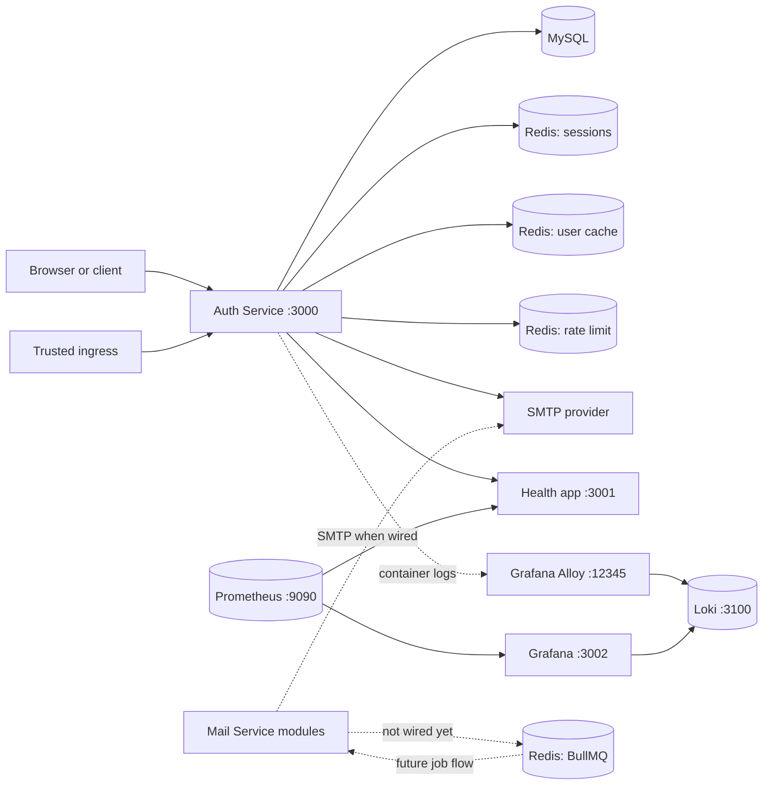

# Copyright and Usage Restrictions

© 2026 Urva Patel. All Rights Reserved.

This repository is publicly accessible solely for viewing and evaluation.

Without prior written permission from the copyright owner, you may not copy or download this repository for reuse, modify or redistribute it, exploit it commercially, or incorporate it into another project.

No license is granted to use, modify, or distribute this software.


# Authentication & Mail Service

**Authentication & Mail Service** is a Node.js microservice workspace for
production-style user authentication and identity management. The primary
service provides email/password accounts, verification and password-reset
emails, JWT-based sessions, Google OpenID Connect login, and profile
operations. Its surrounding infrastructure adds isolated Redis stores,
MySQL persistence, containerized startup, health probes, Prometheus metrics,
and Grafana/Loki-based observability.

The repository also contains the foundations of an asynchronous mail worker:
a separate BullMQ/Redis module, SMTP client, retry policy, and worker
configuration. At present, authentication emails are sent directly by
`Auth_Service` and the `Mail_Service` entry point is not yet wired into the
authentication flow. See [Current implementation status](#current-implementation-status)
before relying on the worker in a deployment.

## Highlights

- Email/password signup with emailed account verification
- Local authentication through Passport
- Access and refresh JWTs delivered as cookies
- Google OIDC sign-in
- Password reset and change-password flows
- Token verification for trusted ingress/auth-subrequest integrations
- Profile read, update, delete, and lookup operations
- MySQL persistence through Sequelize
- Separate Redis instances for sessions, user/profile caching, and rate limits
- Request validation with Zod
- Helmet security headers, CORS, body limits, and Redis-backed rate limiting
- Structured Pino logs with sensitive headers redacted
- Startup, liveness, readiness, and Prometheus metrics endpoints
- Docker Compose infrastructure for local integration and evaluation
- Jest and Supertest test suites, plus a k6 load-test harness

## Architecture



### Runtime services

| Component | Responsibility | Host access |
|---|---|---:|
| `auth_service` | Express API, Passport authentication, identity logic, and direct SMTP delivery | `localhost:3000` |
| Auth health app | Startup, liveness, readiness, and metrics | `localhost:3001` |
| `mysql` | Persistent users, credentials, identity providers, and active reset tokens | `localhost:3306` |
| `redis_session` | Express sessions | Internal by default |
| `redis_user_cache` | Authenticated-user and profile cache | Internal by default |
| `redis_rate_limit` | Distributed API rate-limit state | Internal by default |
| `redis_bullMQ` | Queue storage reserved for the mail worker | Internal by default |
| `mail_service` | Container reserved for the BullMQ/SMTP worker components | No host port published |
| `prometheus` | Metrics collection | `localhost:9090` |
| `grafana` | Metrics and log visualization | `localhost:3002` |
| `loki` | Central log storage | `localhost:3100` |
| `alloy` | Docker log discovery and forwarding to Loki | `localhost:12345` |

The four Redis containers are deliberately separate so session, cache,
rate-limit, and queue concerns do not share eviction behavior or data.

## Request and identity flow

The authentication API follows a layered structure:

```text
routes -> validators/middleware -> controllers -> services -> repositories
                                                   -> MySQL / Redis / SMTP
```

1. A client submits an auth request to `/v1/auth/...`.
2. Strict request validators and common security middleware process the input.
3. Passport or service-level logic authenticates the request and performs the
   required database work.
4. Successful login sets access and refresh cookies. Access tokens can also be
   checked from the `Authorization` header at `/v1/auth/verify`.
5. A trusted reverse proxy may use `/v1/auth/verify` as an auth subrequest and
   forward the returned identity headers to the profile endpoints.

Profile routes do not trust a browser-supplied bearer token directly. They
require identity headers accompanied by `INGRESS_SHARED_SECRET`, which is
intended to form a boundary between the service and a trusted ingress.

## Repository layout

```text
.
├── Auth_Service/
│   ├── src/                   # API, health app, Passport, services, repositories
│   ├── tests/                 # Jest, Supertest, and k6 suites
│   ├── migrations/            # Sequelize schema migrations
│   ├── seeds/                 # Development seed data
│   ├── conf/redis/            # Redis configurations
│   ├── scripts/               # Service-level shell helpers
│   └── .env.example
├── Mail_Service/
│   ├── src/                   # BullMQ queue, worker, SMTP service, and config
│   ├── conf/redis/            # BullMQ Redis configuration
│   ├── scripts/               # Service-level shell helpers
│   └── .env.example
├── conf/
│   └── monitoring/            # Prometheus and Alloy configuration
├── docker-compose.yml         # Complete local container topology
├── build.sh                   # Foreground build and startup
├── build:d.sh                 # Detached build and startup
├── start.sh                   # Foreground startup
├── start:d.sh                 # Detached startup
└── stop.sh                    # Stop running containers
```

More focused documentation is available in
[Auth_Service/README.md](Auth_Service/README.md), including details on its
internal layers, security model, routes, and load-testing options.

## Prerequisites

For the Docker Compose workflow:

- Docker with Docker Compose v2
- Node.js 22+ and npm only if you also run host-side commands
- An SMTP account if you want signup verification or password-reset emails
- Google OAuth credentials if you want Google OIDC login

For a non-containerized authentication-service run:

- Node.js 22+
- npm
- MySQL 8
- Three reachable Redis instances

MongoDB variables remain in the examples and configuration, but MongoDB is not
started by the root Compose file and its connection is currently disabled in
the authentication startup path.

## Quick start

Run all root commands from the repository root.

### 1. Create environment files

```bash
cp Auth_Service/.env.example Auth_Service/.env
cp Mail_Service/.env.example Mail_Service/.env
```

Fill in `Auth_Service/.env` before starting Compose. At minimum, provide:

```dotenv
MYSQL_USER=
MYSQL_PASSWORD=
MYSQL_DATABASE=
REDIS_PASSWORD=

JWT_SECRET=
JWT_ACCESS_TOKEN_SECRET=
JWT_REFRESH_TOKEN_SECRET=
JWT_PASSWORD_RESET_TOKEN_SECRET=
SESSION_SECRET=
BASIC_SIGNIN_AES_256_GCM_TOKEN_SECRET=
INGRESS_SHARED_SECRET=

EMAIL_HOST=
EMAIL_FROM=
```

For private SMTP servers, also provide `EMAIL_USER` and `EMAIL_PASSWORD`.
For a direct local run without Compose, also set the three role-specific Redis
passwords: `SESSION_REDIS_PASSWORD`, `USER_CACHE_REDIS_PASSWORD`, and
`RATE_LIMIT_REDIS_PASSWORD`.
Generate unrelated cryptographic values for the JWT and token secrets; for
example:

```bash
openssl rand -base64 32
```

The root scripts use `Auth_Service/.env` both for Compose variable
substitution and as the mounted environment file loaded by the authentication
process. Keep real environment files out of version control.

### 2. Build and start the stack

```bash
./build:d.sh
```

For subsequent starts without rebuilding:

```bash
./start:d.sh
```

Use `./build.sh` or `./start.sh` instead when you want foreground logs.
`build.sh` and `build:d.sh` also run `docker image prune -f` after startup.

### 3. Apply database migrations

```bash
docker compose \
  --env-file ./Auth_Service/.env \
  exec auth_service npm run db:migrate
```

Optionally load development seed data:

```bash
docker compose \
  --env-file ./Auth_Service/.env \
  exec auth_service npm run db:seed
```

### 4. Verify the service

```bash
curl http://localhost:3001/startup
curl http://localhost:3001/live
curl http://localhost:3001/ready
curl http://localhost:3001/metrics
```

The readiness endpoint checks the startup state and MySQL connectivity. The
main API is available at `http://localhost:3000`.

## Configuration

The example variable lists are:

- [Auth_Service/.env.example](Auth_Service/.env.example)
- [Mail_Service/.env.example](Mail_Service/.env.example)

### Authentication service

| Group | Important variables | Purpose |
|---|---|---|
| Application | `PORT`, `HEALTH_APP_PORT`, `API_BASE_URL`, `FRONTEND_BASE_URL`, `ENVIRONMENT` | Listener ports, externally generated links, and CORS origin |
| Request limits | `BODY_SIZE_LIMIT`, `MAX_CONNECTIONS`, `REQ_TIMEOUT_MS`, `REQ_HEADERS_TIMEOUT_MS` | Payload, connection, and timeout limits |
| MySQL | `MYSQL_HOST`, `MYSQL_PORT`, `MYSQL_USER`, `MYSQL_PASSWORD`, `MYSQL_DATABASE` | Primary identity store |
| Session Redis | `SESSION_REDIS_HOST`, `SESSION_REDIS_PORT`, `SESSION_REDIS_PASSWORD`, `SESSION_REDIS_TTL` | Server-side Express sessions |
| User-cache Redis | `USER_CACHE_REDIS_HOST`, `USER_CACHE_REDIS_PORT`, `USER_CACHE_REDIS_PASSWORD` | User existence and profile cache |
| Rate-limit Redis | `RATE_LIMIT_REDIS_HOST`, `RATE_LIMIT_REDIS_PORT`, `RATE_LIMIT_REDIS_PASSWORD` | Shared rate-limit counters |
| JWT/session | `JWT_*`, `SESSION_*`, cookie options | Access, refresh, reset, and server-session tokens/cookies |
| Signup token | `BASIC_SIGNIN_AES_256_GCM_TOKEN_SECRET`, `BASIC_SIGNIN_AES_256_GCM_TOKEN_TTL_SECONDS` | Encrypted, short-lived signup verification token |
| SMTP | `EMAIL_HOST`, `EMAIL_PORT`, `EMAIL_SECURE`, `EMAIL_USER`, `EMAIL_PASSWORD`, `EMAIL_FROM` | Direct verification/reset delivery |
| Google OIDC | `OIDC_GOOGLE_*` | Google sign-in credentials, callback URL, and scopes |
| Ingress trust | `INGRESS_SHARED_SECRET` | Authenticates identity headers supplied to profile routes |

Within Compose, use service names such as `mysql`, `redis_session`,
`redis_user_cache`, and `redis_rate_limit` as internal hosts. Use `localhost`
only from host-side tools connecting to published ports.

> **Rate-limit variable name:** the runtime reads `RATE_LIMIT_REDIS_*` (without
> the extra `ER`). Compose injects these values itself; direct local runs
> should use the runtime spelling shown in the table.

### Mail service

The mail modules support:

- BullMQ connection settings (`BULLMQ_REDIS_*`)
- Queue name, retry attempts, backoff, and completed/failed job retention
- Worker concurrency, stalled-job thresholds, and lock duration
- SMTP host, credentials, sender, and delivery timeout
- A configurable forced-close timeout

The root Compose file currently creates `redis_bullMQ`, but it does not inject
the mail service's complete environment or start a mail worker entry point.

## API overview

All public application routes are versioned below `/v1`.

| Method | Path | Authentication/input | Description |
|---|---|---|---|
| `POST` | `/v1/auth/signup` | `{ email, password, name }` | Creates a pending signup and sends a verification email |
| `GET` | `/v1/auth/verify-email` | `token` query parameter | Verifies and completes account creation |
| `POST` | `/v1/auth/login` | `{ email, password }` through Passport basic auth | Sets access/refresh cookies and returns the public profile |
| `POST` | `/v1/auth/verify` | Bearer access token | Validates a token and returns identity in `x-user-*` headers |
| `POST` | `/v1/auth/refresh` | Refresh-token cookie | Issues a new access-token cookie |
| `POST` | `/v1/auth/logout` | Current cookies, when present | Clears access and refresh cookies |
| `POST` | `/v1/auth/forgot-password` | `{ email }` | Sends a reset link when the account exists |
| `POST` | `/v1/auth/change-password` | `{ token, newPassword }` | Consumes the reset token and changes the password |
| `GET` | `/v1/auth/oidc/google` | Browser redirect | Starts Google OIDC |
| `GET` | `/v1/auth/oidc/google/callback` | OIDC callback | Completes Google authentication |
| `GET` | `/v1/profile/me` | Trusted ingress identity | Reads the authenticated profile |
| `PATCH` | `/v1/profile/me` | Trusted ingress identity plus validated body | Updates the authenticated profile |
| `DELETE` | `/v1/profile/me` | Trusted ingress identity | Deletes the authenticated profile |
| `GET` | `/v1/profile/:id` | Trusted ingress identity | Returns a full own profile or public fields for another user |
| `GET` | `/v1/auth/csrf` | None | Reserved route; currently returns `501` |

Invalid request bodies return a validation error. Unknown routes and expected
application errors are handled by central middleware.

### Trusted ingress for profile routes

Profile requests require:

```text
x-user-id: <user UUID>
x-ingress-auth-secret: <INGRESS_SHARED_SECRET>
```

The ingress must:

1. Authenticate the caller.
2. Discard any client-supplied identity or shared-secret headers.
3. Set the headers only after a successful auth subrequest.
4. Use the UUID returned by `/v1/auth/verify`.
5. Restrict direct network access to the authentication service.

Treat `INGRESS_SHARED_SECRET` as a production secret. Someone who can reach the
service and possess that value can impersonate users.

## Health and metrics

The health application is independent of the main API listener.

| Endpoint | Meaning |
|---|---|
| `GET /startup` | Returns `200` once process startup has completed |
| `GET /live` | Reports process liveness; becomes `503` during shutdown |
| `GET /ready` | Reports startup completion and MySQL readiness |
| `GET /metrics` | Exposes default Node.js and HTTP metrics in Prometheus format |

Alloy discovers Docker container logs and forwards them to Loki. Pino output is
structured JSON in non-development configurations, and request logs correlate
work through request identifiers while redacting cookie, authorization, and
ingress-secret headers.

See the [observability configuration](conf/monitoring/) for Prometheus and
Alloy. Grafana dashboards and data sources are not provisioned automatically
by the current Compose setup.

## Development

### Run the authentication service locally

```bash
cd Auth_Service
npm ci
cp .env.example .env
# Fill in MySQL/Redis/secret configuration.
npm run db:migrate
npm run dev
```

Use `npm start` for a plain Node.js process. The three Redis roles must be
reachable before startup; MySQL must also be migrated and available.

### Tests and linting

```bash
cd Auth_Service
npm test
npm run lint
npm run test:coverage
```

The authentication tests mock external services and cover validators,
controllers, services, middleware, repositories, errors, configuration, and
route-level behavior.

For load tests, see
[Auth_Service/tests/README.md](Auth_Service/tests/README.md) and
[Auth_Service/tests/load/.env.example](Auth_Service/tests/load/.env.example).
Run load scenarios only in a disposable environment with dedicated test data.

## Common operations

| Goal | Command |
|---|---|
| Build/start in foreground | `./build.sh` |
| Build/start in background | `./build:d.sh` |
| Start in foreground | `./start.sh` |
| Start in background | `./start:d.sh` |
| Stop containers without removing them | `./stop.sh` |
| Inspect status | `docker compose --env-file ./Auth_Service/.env ps` |
| Follow auth logs | `docker compose --env-file ./Auth_Service/.env logs -f auth_service` |
| Apply migrations | `docker compose --env-file ./Auth_Service/.env exec auth_service npm run db:migrate` |
| Stop and remove the Compose project | `docker compose --env-file ./Auth_Service/.env down` |

Named volumes retain MySQL, Redis, metrics, dashboard, and log data across
ordinary stop/down operations. Deleting volumes is destructive:

```bash
docker compose --env-file ./Auth_Service/.env down -v
```

## Security considerations

- Do not commit `.env` files, SMTP credentials, OAuth secrets, JWT secrets, or
  ingress shared secrets.
- Use different random values for each signing, encryption, session, and
  ingress secret.
- Set secure cookies, exact CORS origins, and HTTPS correctly in production.
- Keep the profile API behind a trusted ingress and block direct external
  access.
- Protect Redis persistence: authenticated profiles can be cached there.
- Do not expose MySQL, Redis, or observability services to untrusted networks.
- Treat email verification, reset, and queued-delivery data as sensitive.
- Use dedicated test credentials and disposable data for integration and load
  tests.

## Current implementation status

The repository is best understood as an identity service with an evolving
mail-worker subsystem:

- Authentication email delivery currently uses Nodemailer directly from
  `Auth_Service`; it does not publish jobs to BullMQ.
- `Mail_Service` contains queue, worker, SMTP, and shutdown-related building
  blocks, but `src/server.js` is empty, no worker is instantiated by an entry
  point, and the package has no `start` script.
- The `mail_service` Docker image declares an `npm start` command, so the
  current Compose definition does not yet provide a functioning mail process.
- The current Prometheus target in
  [conf/monitoring/prometheus.yml](conf/monitoring/prometheus.yml) is `server:3001`,
  while the Compose authentication service is named `auth_service`; the target
  must be aligned before Prometheus can scrape the metrics endpoint.
- MongoDB code and variables remain available, but MongoDB is not connected
  during startup and is not required by the current identity flow.

These are documented implementation gaps rather than guarantees about future
behavior.

## Troubleshooting

### Compose reports a missing secret

The root scripts load `Auth_Service/.env` with `--env-file`. Confirm that the
file exists and contains `MYSQL_PASSWORD`, `MYSQL_DATABASE`, and
`REDIS_PASSWORD`.

### The auth container exits during configuration

Verify all required MySQL and Redis values, then inspect:

```bash
docker compose --env-file ./Auth_Service/.env logs auth_service
```

Ensure the environment uses the Compose hostnames for database services rather
than `localhost`.

### Readiness remains unavailable

Check MySQL health and confirm migrations ran:

```bash
docker compose --env-file ./Auth_Service/.env ps
docker compose --env-file ./Auth_Service/.env exec auth_service npm run db:migrate
```

### Email signup or password reset fails

Confirm SMTP host, port, encryption mode, sender, and credential pairing.
Verification and reset requests currently wait for direct SMTP delivery, so
mail-provider errors are returned by the authentication API.

### Prometheus cannot discover the auth service

The configured scrape hostname currently differs from the Compose service
name. Align the Prometheus target with `auth_service:3001` before expecting the
authentication metrics to appear.

### Redis data or schema appears stale

Rebuild after dependency changes, rerun migrations for schema changes, and use
`down -v` only when all local data may be safely erased.
